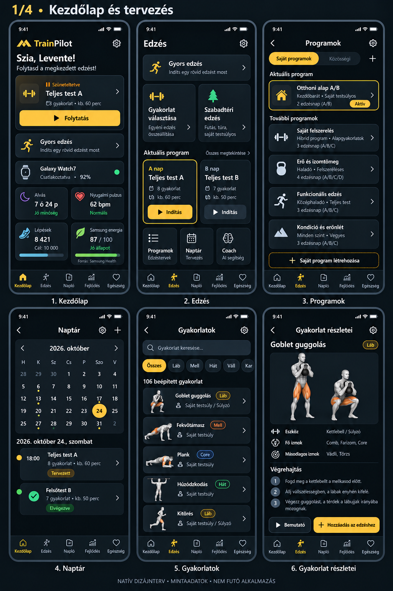
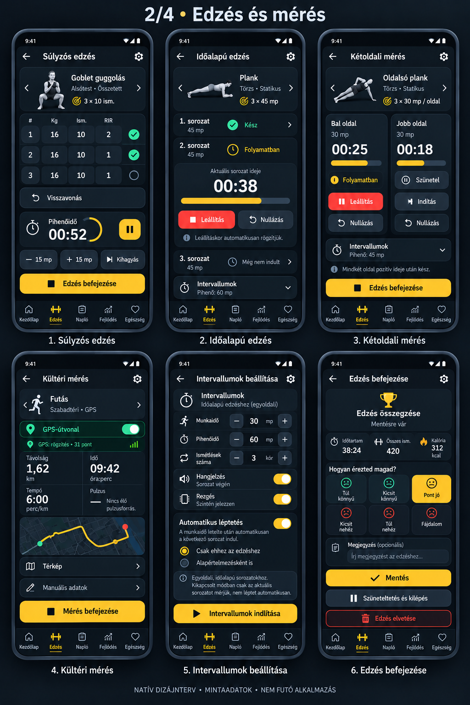
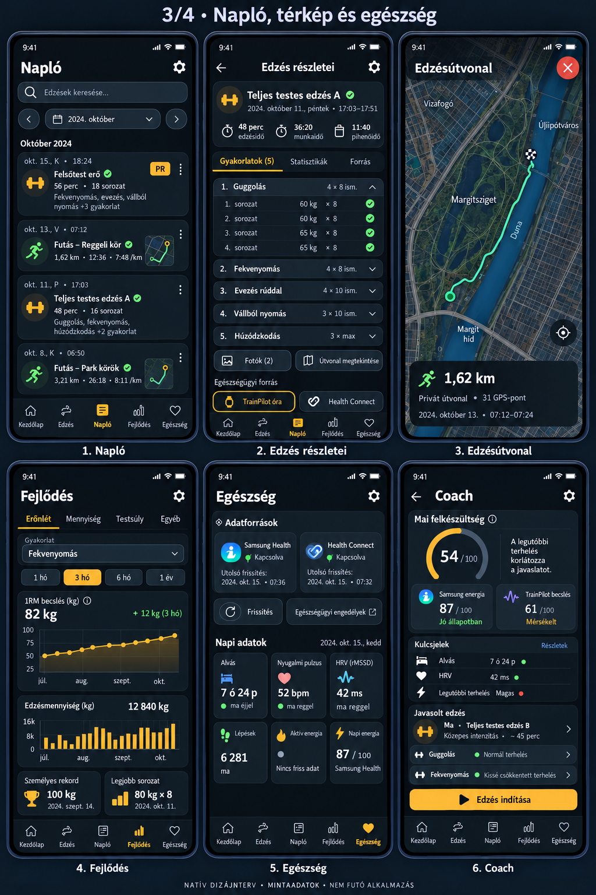
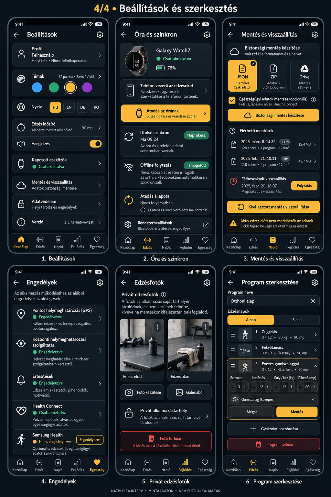

# TrainPilot Native V2 – eredeti natív mockupok (24 nézet / 4 PNG)

**Mind a négy képtábla fizikailag ebben a repóban van**. Ez a 2026-10-24-i, az eredeti natív migrációs ághoz tervezett grafikai referencia, **nem** PR277 WebView-screenshot és **nem** kész alkalmazásfotó.

Az importáló GitHub Actions minden PNG **SHA-256** értékét az eredeti [MANIFEST.json](MANIFEST.json) szerint ellenőrizte, és a Git blob-azonosítók megegyeznek a forrás repó eredeti képeinek azonosítóival.

## 01 – Kezdőlap, főoldalak és tervezés

[Teljes méret](01-main-pages-and-planning.png)

## 02 – Edzések és mérések

[Teljes méret](02-workouts-and-measurement.png)

## 03 – Napló, térkép és egészség

[Teljes méret](03-journal-maps-and-health.png)

## 04 – Szerkesztés és beállítások

[Teljes méret](04-editing-and-settings.png)

## Megvalósítási szabályok
- A képek esztétikai/ergonómiai etalonok; a **végleges felső 5+3 menürendszer** a [navigációs döntés](../../docs/01-NAVIGACIO-5-PLUS-3.md) szerint kötelező. A korábbi alsó tabsor nem implementálható.
- A 24 képernyő részletes működési szerződése: [02-SCREEN_CONTRACTS_24.md](../specifications/02-SCREEN_CONTRACTS_24.md).
- A kép nem specifikálhat hamis GPS-, Health-, Coach- vagy naplóadatot. A felület a valós adatot és hiányállapotot jeleníti meg.
- A V2 app kódját és tényleges képernyőit kizárólag az AI Studio hozza létre, külön tesztekkel; a képek önmagukban nem elfogadási bizonyítékok.

Eredeti nyilvános forrás: [TrainPilot-AI-Studio natív mockupok](https://github.com/fuloplevente1998/TrainPilot-AI-Studio/tree/d57a184c22579eb22bffd7756e030e498aa200f3/docs/reference/native/design/mockups).
